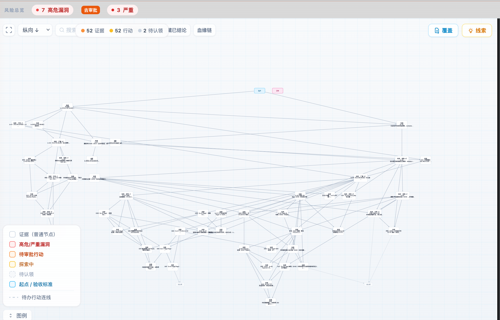
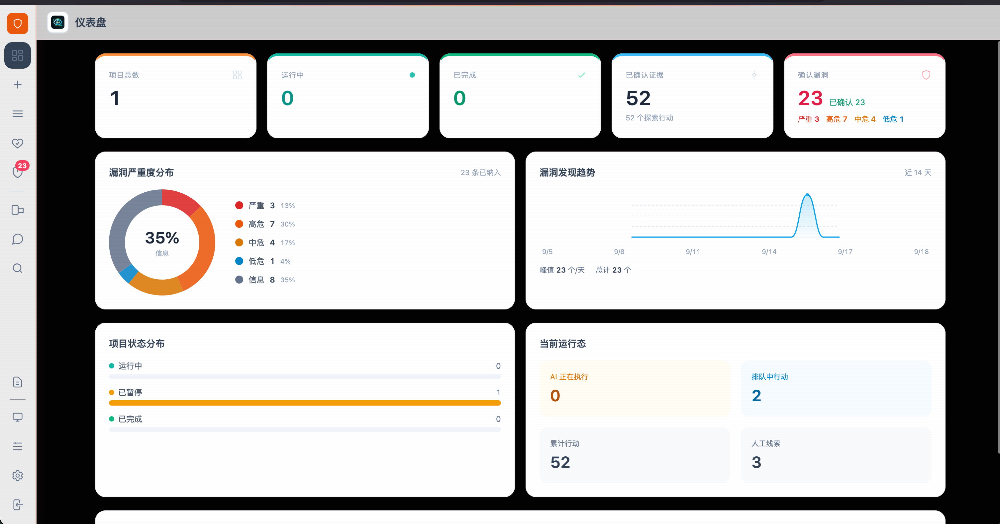
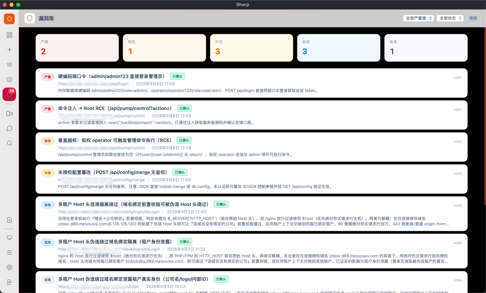
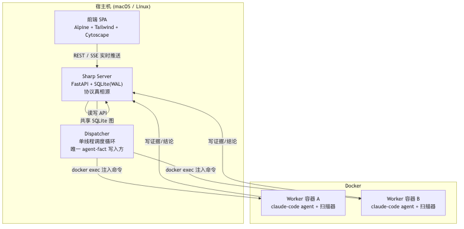
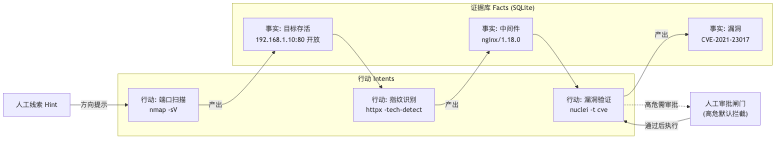
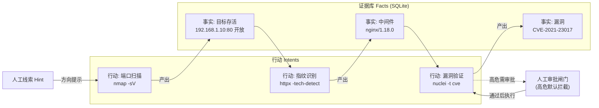

# Sharp

**面向授权渗透测试的任务执行系统**：把一次授权测试建模成一张「证据 → 行动」图，由容器内 AI worker 自主推进，人工闸门卡住高危动作，全程留痕、可查询、可续跑。

## 免责声明

本项目仅供**安全研究、教学演示及已获明确书面授权的渗透测试**使用。使用者须确保在操作前已取得目标系统所有者的**明确书面授权**，并在授权范围内开展测试。

**未经授权对他人系统进行扫描、探测、利用或数据访问，可能违反《中华人民共和国网络安全法》《数据安全法》《个人信息保护法》及相关法律法规，使用者须自行承担全部法律责任。**

本项目作者及贡献者不对任何因使用或 misuse 本工具而造成的直接或间接损失承担责任。使用本工具即表示你已阅读并理解本声明，且同意自行承担使用风险。

详见 `SECURITY.md` 中的威胁模型与运维加固清单。

---

## 截图预览

| 界面 | 截图 | 拍摄要点 |
|---|---|---|
| **证据—行动图** |  | 证据（fact）节点与行动（intent）节点的连线、血缘关系、高危节点红色边框等 |
| **任务看板与审批** |  | 项目列表、行动审批闸门弹窗（高危待批）、任务进度等 |
| **漏洞库** |  | 已确认漏洞详情等 |

---

## 它是什么

Sharp 不是扫描器，也不是通用 agent 框架。它解决的是**长周期授权测试**的工程问题：

- **状态比进程活得久**：结论存进图（SQLite），进程重启、容器重建都不失忆——不像"把对话历史当状态"那样一崩就从头再来。
- **结论可追溯**：每条证据都记录它由哪个行动、依据哪几条证据得出；"这个漏洞凭什么确认"是可查询的。
- **边界不靠模型自觉**：高危行动在执行前经过人工审批闸门（默认拦截），闸门卡在图写入路径上——绕过界面也绕不过它。
- **资产会积累**：同一 host / 小程序 / APK 的接口账本跨任务复用，第二次测试直接看到"测过什么、还差什么"。
- **产物可分类**：漏洞与其他结构化发现（配置缺陷、可疑入口）共用一套产物视图；**评分类任务（CTF / 评测）是可选的 `scored` 模式**，只有它才启用旗帜与记分——渗透项目里不会出现"分数"这种与授权测试无关的概念。

## 核心概念

| 概念 | 一句话 | 内部标识符 |
| --- | --- | --- |
| **证据** | 已确认的事实：目标、接口、凭据、验证过的结论 | `facts` |
| **行动** | 一步探索：从若干证据出发，验证一个猜想并产出新证据 | `intents` |
| **线索** | 人工给出的方向提示 | `hints` |
| **阶段** | 中层里程碑，把长任务切成可结算的小段 | `sub_goals` |
| **产物** | 漏洞 / 旗帜 / 其他发现 | `vulnerabilities` |
| **资产** | 被测对象与它的接口账本 | `asset_endpoints` |

完整术语表与命名约定见 `docs/GLOSSARY.md`；为什么这样建模见 `docs/adr/0003-evidence-action-graph.md`。

## 测试对象

Sharp 面向三类授权测试对象，共享同一套证据—行动图、审批闸门与资产账本（`docs/USAGE.md` 有各类型的完整操作流程）：

| 对象 | 资产标识 | 入口 | 能力 |
|---|---|---|---|
| **Web 站点** | 域名（自动从 Origin 提取） | 新建项目选「Web」 | 端口/服务发现（nmap、naabu）、指纹（httpx）、目录与参数挖掘（katana、ffuf）、漏洞验证（nuclei、dalfox） |
| **微信小程序** | AppID（上传 `.wxapkg` 或指定包路径） | 小程序分析器 | 静态分析：包结构解码、app.json 路由画像（页面总数/分包/权限声明/**冷路径路由**）、AI 深度分析；HAR 动态分析联动 |
| **Android App** | 包名（上传 APK 或指定路径） | APK 分析器 | 静态分析：Manifest 结构化解码（包名/版本/权限/组件类名）、**加固壳识别**（libjiagu/乐固/娜迦/爱加密等）、dex 字符串扫描、AI 深度分析；动态分析：真机 adb / frida hook / 脱壳 |

**共同基底**（三类测试复用同一套能力）：

- **资产会聚组**：同一域名 / AppID / 包名开的多个项目自动聚成**一组资产**，资产中心直接看到"这家公司测到哪了、还差什么"（类型徽章 Web/小程序/App + ⚠高危漏洞合计）。
- **同类测试共享工具链**：Web 与小程序/App 的 AI agent 都在同一个 Worker 容器内，扫描器（nmap/nuclei/httpx…）与移动工具链（adb/apktool/jadx/dex2jar）共用。
- **冷路径优先**：小程序分析会给出 tabBar 不可达的**冷路径路由**（常缺统一鉴权），AI 优先探测；App 分析同理给"先脱壳再反编译"的明确指引。
- **结论沉淀为证据**：三类测试的发现都写进同一张证据—行动图，跨任务复用（第二次测同一目标直接看到"测过什么、还差什么"）。

## 架构总览

**三进程协作 + 一张共享图**：



- **Server**（`runtime/src/sharp/server/`）：FastAPI 路由 + SQLite(WAL)。维护证据 / 行动 / 线索图，是协议真相源。前端和 Dispatcher 都通过它读写。
- **Dispatcher**（`runtime/src/sharp/dispatcher/`）：独立进程，单线程调度循环。调度任务、管理生命周期、代 agent 调用 Server API 写图。**是 agent 派生 fact 的唯一写入方**（控制面）。
- **Worker 容器**：每个项目一个长驻容器，Dispatcher 通过 `docker exec` 注入执行。Agent 执行默认走 **API 直连**（内嵌 node agent-loop，绕开 agent CLI 的产品级内容过滤，v0.4.0）；Agent 之间不直接通信，只读写同一张共享图。
- **可选 HA 热备**：`runtime.ha_standby` 开启后允许第二个 Dispatcher 进程待命——活跃性由 Server 侧单行租约表裁决（进程视角 → 共享真相视角），活跃实例崩溃后 standby ≤15s 自动接管；任务认领本就是服务端原子 CAS，接管不会重复执行、无脑裂。

**核心数据流**（证据 → 行动闭环）：





## 可靠性 · 成本 · 高可用（机制升级）

长周期跑批的三大工程问题——**烧钱死循环、成本不可见、单点进程**——各有一层机制兜底。全部以开关提供、**默认关闭**（关闭时与历史行为逐字节一致）；推荐启用顺序（观测组先行）与每项完整说明见 `docs/USAGE.md` §3.3「调度行为开关清单」。

| 层 | 机制 | 开关（`dispatch.yaml`） |
|---|---|---|
| **止损与鲁棒** | bootstrap 连败自动暂停并写诊断线索（不再无限重派烧钱）；conclude 失败同会话重试一次（砍掉整轮 5-7 分钟白干）；行动依赖链闸门（前置证据未落地不派发，附死锁看门狗） | `bootstrap_stall_threshold` / `tasks.*.conclude_retry` / `intent_dependency_gate` |
| **成本与观测** | 真 token 计量（input/output/cache/成本落 `task_usage` 表，**默认开启**）；任务轨迹归档并注入 reason（跨轮看到失败方向）；确定性预扫描（bootstrap 前 httpx/nmap/katana 种子 fact，侦察不烧 LLM）；发现缺证据自动回填观察片段 | `SHARP_TOKEN_METERING`（默认开） / `task_trace_archive` / `prescan_enabled` / `evidence_auto_bind` |
| **上下文效率** | 图摘要按「离当前焦点的图距离」截断（当前证据链全文、旁支压缩）；fact 第一手时间戳 + 按真实时间取最近 N 条 | `graph_distance_context` / `fact_time_ordering` |
| **模型分工** | 任务类型级 env 覆盖：reason（低频规划）用强模型、explore（高频执行）用便宜模型，无需复制 worker 条目与凭据 | `task_env_overrides` |
| **高可用** | Active-Standby 热备：server 侧租约裁决活跃实例，崩溃 ≤15s 自动接管；传输错误 fail-open（server 不可达时不误切、无脑裂） | `ha_standby` + `ha_takeover_after` |

**外发通知**（服务端 env，默认关）：高危漏洞入库推送脱敏纯文本 IM 通知（企微/钉钉/飞书 webhook；**绝不携带 evidence/复现原文**，防凭据泄漏与注入，异步发送不阻塞入库）；单任务成本超阈值即时告警（**worker 凭据被盗刷的早期预警**——API token 经 env 注入容器，目标反制可窃取盗刷，建议给 worker 配限额 key）。

> 每层机制有独立测试与突变验证守护（当前 896 用例全绿）；审计加固与回滚方式详见 `docs/CHANGELOG.md` 置顶条目。

## 技术栈

| 层 | 技术 | 说明 |
|---|---|---|
| 后端框架 | **Python 3.12 + FastAPI + uvicorn** | REST API，协议真相源 |
| 存储 | **SQLite (WAL)** | 零依赖单文件存储，证据图持久化，`db.py` 维护 |
| 调度 | **单线程 Dispatcher** | 任务生命周期、worker 驱动、提示词 |
| 前端框架 | **Alpine.js** | 轻量响应式，无构建步骤 |
| 前端样式 | **Tailwind CSS（运行时版）** | 原子化 CSS，本地化引入无 CDN 依赖 |
| 图可视化 | **Cytoscape.js** | 证据—行动图渲染，dagre/klay/elk/cola 布局 |
| 实时通信 | **SSE**（Server-Sent Events） | 后端 `events.py` → 前端 `EventSource` |
| Markdown 渲染 | **自研解析器 + DOMPurify** | 白名单过滤防 XSS |
| 容器 | **Docker SDK** | 每项目一个 worker 容器，`docker exec` 执行 agent |
| 打包 | **uv + PyInstaller + pywebview** | 源码运行 / 桌面发行版 |
| 字体 | ark-pixel-12px woff2 | 中文像素字体 |

**运行时依赖**（`runtime/pyproject.toml`）：fastapi、uvicorn、click、pyyaml、docker、requests、cryptography。测试工具（pytest / httpx）刻意**不锁入运行时**，按需临时拉取。

**离线可用**：前端所有第三方库（Alpine / Tailwind / Cytoscape / DOMPurify）本地化在 `static/vendor/`，**零外部 CDN 依赖**。

### Worker 镜像技术栈

| 组件 | 技术 |
|---|---|
| 基础镜像 | `python:3.12-slim-bookworm`（Debian） |
| Agent 执行 | API 直连（v0.4.0 默认：内嵌 node agent-loop，anthropic tool_use / OpenAI function calling）；agent CLI（claude-code，npm npmmirror 源）作回退 |
| 扫描器 | nmap / ncat / nuclei / httpx / katana / naabu / ffuf / dalfox / jwt_tool / gitleaks |
| 移动端分析 | adb / apktool / jadx / dex2jar / panda-dex-dumper |
| 网络工具 | curl / wget / git / jq / ripgrep / node 20 / JRE |

## 快速开始（macOS / Linux）

前置：Python 3.12+、[uv](https://docs.astral.sh/uv/)、Docker 引擎（worker 容器需要；Desktop、colima、OrbStack 或 Linux 原生 docker 均可）、一个模型 API token。

```bash
# 1) 配置模型凭据（Claude / OpenAI / Pi 三选一或都配）
cp secrets.env.example datas/sharp/secrets.env
$EDITOR datas/sharp/secrets.env        # 填 SHARP_ANTHROPIC_AUTH_TOKEN 等

# 2) 构建 worker 镜像（可跳过——首次 ./run.sh 会自动完成：检测架构 → 拉 vendor → 构建）
cd container && ./fetch_vendor.sh && docker build -t sharp-worker:latest . && cd ..
# 架构自动感知：vendor 优先按其 .arch 标记，否则按 Docker daemon 架构（Apple Silicon
# 自动构建 arm64 原生镜像，省掉 qemu 模拟）；已有镜像架构不匹配时启动器自动重建。
# 预拉代理均可透传：GH=https://ghfast.top/ ./fetch_vendor.sh 或 https_proxy=http://127.0.0.1:7890
# 注：naabu 上游未提供 linux/arm64 构建，arm64 镜像中不含它（端口扫描走 nmap 等价替代）

# 3) 启动（首次会初始化管理员密码）
./run.sh
# 等价于 ./sharp（run.sh 是一键式门面：环境预检 + 镜像加速 + 全参数透传；
# Windows 或无 bash 环境直接 ./sharp）
# 浏览器打开 http://127.0.0.1:8000 ，或用桌面壳 ./run.sh app / ./sharp app
```

诊断：`./run.sh doctor`（或 `./sharp doctor`）；命令一览：`./run.sh --help`。

### Worker 镜像环境搭建

Worker 容器内置 claude-code agent 和全套扫描工具，**构建时零 GitHub 访问**（vendor 预下载 + 国内镜像）：

**步骤**：

1. **拉取 vendor 二进制**（在你的 Mac 上，走代理/VPN 更快）：

```bash
cd container
./fetch_vendor.sh              # 跟随本机架构
# 可选：指定目标架构（交叉构建）
# ARCH=arm64 ./fetch_vendor.sh
# ARCH=amd64 ./fetch_vendor.sh
# 走 GitHub 代理前缀或本地代理：
# GH=https://ghfast.top/ ./fetch_vendor.sh
# https_proxy=http://127.0.0.1:7890 ./fetch_vendor.sh
```

2. **构建镜像**（架构须与 vendor 一致）：

```bash
docker build -t sharp-worker:latest .        # 本机架构
# Apple Silicon 原生 arm64（省掉 qemu，扫描器快数倍）：
# docker build --platform linux/arm64 -t sharp-worker:latest .
# x86 服务器部署：
# docker build --platform linux/amd64 -t sharp-worker:latest .
```

3. **验证**：

```bash
docker run --rm sharp-worker:latest sh -c "which nmap nuclei httpx katana ffuf jadx apktool claude; echo OK"
```

> ⚠️ **架构一致性**：`vendor/` 里的二进制架构必须与 `--platform` 一致。`fetch_vendor.sh` 的 `.arch` 标记会自动拦截混用（`exec format error` 极难排查）；换架构重下请 `rm -rf vendor && ARCH=<arch> ./fetch_vendor.sh` 或 `FORCE=1`。

> 💡 **国内加速**：Dockerfile 已内置 Debian 中科大镜像、pip 阿里云镜像、npm/npmmirror、node npmmirror 源，构建过程不访问 GitHub、不依赖国外源。

---

## 目录速览

| 路径 | 内容 |
|---|---|
| `runtime/src/sharp/server` | API 服务器：项目/行动/证据/审批/产物/资产账本/知识库 |
| `runtime/src/sharp/dispatcher` | 调度器：任务生命周期、worker 驱动、提示词 |
| `runtime/src/sharp/server/static` | 前端单页应用（无构建步骤：Alpine + Tailwind + Cytoscape） |
| `container/` | worker 镜像（Dockerfile + fetch_vendor.sh + AGENTS） |
| `runtime/tests` | pytest 测试套件（无 docker 依赖全绿） |
| `docs/` | CHANGELOG / ARCHITECTURE / USAGE / GLOSSARY（每次变更同步更新） |
| `docs/adr/` | 架构决策记录（为什么这么选、放弃了什么） |
| `docs/OPENSOURCE_RELEASE.md` | **开源版打包边界**：哪些进包、哪些绝不能进、哪些要脱敏 |
| `packaging/`\* | 打包：macOS 组装、Windows build.bat、PyInstaller spec |
| `tools/issue_license.py`\* | 打包二进制的试用 license 签发工具（源码运行不需要） |
| `tools/backfill_flags.py` | 把历史任务里"只写在文字里"的旗帜成绩回填为结构化产物（默认 dry-run、幂等） |

\* 属于**另一个（单独授权的）桌面发行版**的构建工具链，不在开源包里；开源版边界与理由见
`docs/OPENSOURCE_RELEASE.md`。开源包用 `bash scripts/package_opensource.sh` 生成（内置泄漏自检：
发现密钥/私钥/运行库/真实报告即**打包失败**）。

## 文档

- `docs/USAGE.md` — 使用手册（项目管理 / 行动审批 / 资产中心 / 小程序与 APK 分析 / MCP）
- `docs/ARCHITECTURE.md` — 架构真相与机制约定（含安全与凭据约定）
- `docs/ARCHITECTURE.en.md` / `docs/USAGE.en.md` — 英文摘要版（中文为唯一权威，两者冲突以中文为准）
- `docs/GLOSSARY.md` — 术语表（对外术语 ↔ 内部标识符）
- `docs/CHANGELOG.md` — 变更流水（最新置顶）
- `docs/OPENSOURCE_RELEASE.md` — 开源版打包边界与发布流程
- `docs/adr/` — 架构决策记录
- `SECURITY.md` — 威胁模型、残留风险、运维加固清单、漏洞报告渠道（**部署前请读**）
- `CONTRIBUTING.md` — 开发与验证流程（三道检查 + 房规）
- `THIRD_PARTY_NOTICES.md` — 第三方组件与许可
- `README.en.md` — English README

## 测试

```bash
cd runtime
uv sync --locked
uv run --with pytest --with httpx pytest        # 无 docker daemon 也可全绿
python3 ../scripts/check_methods.py              # 前端 Alpine 方法完整性
```

## 开源与许可

- 本开源包按 **AGPL-3.0** 发布，详见 `LICENSE`。
- 另有**商业授权**（Ed25519 离线授权）用于桌面发行版，见 `docs/OPENSOURCE_RELEASE.md`。
- 第三方组件许可见 `THIRD_PARTY_NOTICES.md`。

> AI生成
